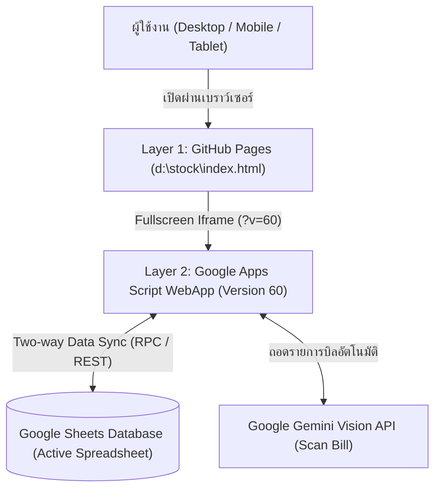

# 📦 ระบบบริหารคลังและขอเบิกพัสดุ สำนักช่าง (Stock Control & Requisition System)

> **คู่มือสถาปัตยกรรมและการพัฒนาต่อเนื่องสำหรับ AI & Developers (AI Handoff & Architecture Blueprint)**
> *จุดประสงค์ของเอกสารนี้: เพื่อให้ AI Agent หรือนักพัฒนาท่านต่อไปสามารถรับช่วงต่องาน พัฒนาฟีเจอร์ใหม่ แก้ไขบัก หรือ Deploy ระบบได้อย่างราบรื่น 100% ไร้รอยต่อ โดยไม่ต้องเสียเวลาเดาหรือค้นหาบริบทเดิม*

---

## 📌 1. ข้อมูลสรุประบบและสถานะปัจจุบัน (Executive Summary & Live State)

* **ชื่อโครงการ:** ระบบบริหารคลังและขอเบิกพัสดุ สำนักช่าง (Stock Control & Requisition System)
* **เวอร์ชัน Production ล่าสุด:** **Version 60**
* **Deployment ID (Google Apps Script):** `AKfycbwXSGV8gcjoPexYTqV9bPC2jBxpoUYnb934F5FcQe9_qoi-wubSB5gZmqVZWWejf_ogqA`
* **Production Web App URL:** `https://script.google.com/macros/s/AKfycbwXSGV8gcjoPexYTqV9bPC2jBxpoUYnb934F5FcQe9_qoi-wubSB5gZmqVZWWejf_ogqA/exec?v=60`
* **GitHub Repository:** `https://github.com/takpaoapp/stock-sumnakchang.git` (Branch: `main`)
* **GitHub Pages (Frontend Entrypoint):** `https://takpaoapp.github.io/stock-sumnakchang/`
* **Aesthetic & Design DNA:** สไตล์กระดาษราชการวินเทจ (Vintage Paper & Stock Card Ledger Theme) โทนสีครีมทอง `#f3efe6` / `#fbf5e6` ขอบหินเข้ม `#292524` ฟอนต์สารบรรณ (Sarabun), ฟอนต์หัวเรื่อง (Krub), และฟอนต์รหัสบัญชี (Courier Prime)

---

## 🏛️ 2. โครงสร้างสถาปัตยกรรมระบบ 2 ชั้น (Two-Tier Architecture)

ระบบถูกออกแบบเป็นสถาปัตยกรรมแบบไฮบริดไร้ Server แบบ Standalone เพื่อความเร็วสูงสุดและไม่ต้องเสียค่าดูแลโฮสติ้ง:



### รายละเอียดแต่ละ Layer:
1. **Layer 1: Frontend Wrapper (`d:\stock\index.html`)**
   - ทำหน้าที่เป็น Shell ครอบหน้าจอ ควบคุม Viewport บนมือถือ ล็อค `touch-action: manipulation` (ปลดล็อคการแตะหน้าจอ 0ms ไม่มีดีเลย์ 300ms)
   - ฝัง `iframe` ชี้ไปยัง URL ของ Google Apps Script พร้อมใส่ Query Version Parameter (เช่น `?v=60`) เพื่อบังคับให้เบราว์เซอร์รีเฟรชแคชทุกครั้งที่มีเวอร์ชันใหม่
2. **Layer 2: Google Apps Script WebApp (`d:\stock\gas-web/`)**
   - **`Index.html`:** ซอร์สโค้ด Single Page Application (SPA) ทั้งหมด (HTML + Tailwind CSS CDN + Icons SVG + Vanilla JS) ไม่มี dependencies ก้อนโต โหลดได้เร็วแม้เน็ตช้า
   - **`รหัส.js`:** Backend Engine (Google Apps Script) ทำงานเป็นตัวควบคุมฐานข้อมูล Google Sheets, ตรวจสอบ Authentication, บันทึกการเบิกจ่าย และควบคุมสิทธิ์ Admin
   - **`appsscript.json`:** คอนฟิกูเรชันสิทธิ์ `V8` Runtime และ Manifest ของ Apps Script
   - **`.clasp.json`:** ไฟล์เชื่อมโยง `clasp` ไปยัง Script ID บน Google Cloud

---

## 📂 3. แผนที่โครงสร้างไฟล์ในโปรเจกต์ (Project Directory Map)

```text
d:\stock/
├── .clasp.json                     # (สำรอง) Clasp config
├── .git/                           # Git Version Control
├── .gitignore                      # กำหนดข้อยกเว้น git (exclude gas-web จาก git repo หลัก)
├── favicon.ico, icon-192.png       # PWA Icons สำหรับอุปกรณ์พกพา
├── index.html                      # ⭐ Layer 1: GitHub Pages Wrapper ชี้ iframe ไปยัง GAS Web App
├── manifest.json                   # Web App Manifest สำหรับติดตั้งลงหน้าจอมือถือ (PWA)
├── README.md                       # ⭐ เอกสารคู่มือเล่มนี้ (AI Handover Blueprint)
└── gas-web/                        # ⭐ Layer 2: โฟลเดอร์ซอร์สโค้ดหลักของ Google Apps Script
    ├── .clasp.json                 # Clasp config ชี้ไปยัง Script ID จริง
    ├── appsscript.json             # Apps Script Manifest (V8, TimeZone: Asia/Bangkok)
    ├── Index.html                  # 🔥 UI & Frontend Logic ทั้งหมดของระบบ (5,700+ บรรทัด)
    └── รหัส.js                     # ⚡ Server-side Business Logic & Google Sheets CRUD
```

---

## 🗄️ 4. โครงสร้างฐานข้อมูล Google Sheets (Database Schema)

ฐานข้อมูลทำงานอยู่บน Google Sheets 1 ไฟล์ ประกอบด้วย 6 ตาราง (ชีต) หลักดังนี้:

| ชื่อชีต | หน้าที่และคอลัมน์สำคัญ | ความสัมพันธ์และการตรวจสอบ |
|---|---|---|
| **`Items`** | รายการพัสดุในคลัง (`รหัส SKU`, `ชื่อรายการ`, `หมวดหมู่`, `หน่วยนับ`, `ยอดคงเหลือ`, `จุดสั่งซื้อ Safety Stock`, `ราคาต่อหน่วย`, `สถานที่จัดเก็บ`) | อัปเดตยอดคงเหลืออัตโนมัติเมื่อมีการเบิกจ่าย (`OUT`) หรือรับเข้า (`IN`) |
| **`Departments`** | รายชื่อฝ่าย/กลุ่มงานทั้ง 7 ฝ่ายของสำนักช่าง (`รหัสฝ่าย`, `ชื่อเต็ม`, `ชื่อย่อ`) | ใช้เป็นตัวเลือกแผนกในแบบฟอร์มขอเบิก |
| **`Requisitions`** | หัวเอกสารใบขอเบิก (`เลขที่ใบเบิก`, `วันที่`, `รหัสฝ่าย`, `ชื่อฝ่าย`, `ผู้ขอเบิก`, `ผู้อนุมัติ/ผู้สั่งจ่าย`, `วัตถุประสงค์`, `สถานะ`, `ผู้จ่ายพัสดุ`) | เลขที่ใบเบิกรูปแบบ `REQ-YY-MM-XXXX` |
| **`Requisition_Items`** | รายการพัสดุตามใบเบิก (`เลขที่ใบเบิก`, `รหัส SKU`, `ชื่อรายการ`, `จำนวนขอเบิก`, `จำนวนจ่ายจริง`) | เชื่อมโยงกับ `Requisitions` ด้วย `เลขที่ใบเบิก` |
| **`Stock_Logs`** | ประวัติ Audit Trail การเคลื่อนไหว (`วันเวลา`, `รหัส SKU`, `ชื่อรายการ`, `ประเภท IN/OUT`, `จำนวน`, `คงเหลือหลังทำรายการ`, `เลขที่อ้างอิง`, `ผู้บันทึก`, `หมายเหตุ`) | ห้ามลบ ใช้สำหรับตรวจสอบย้อนหลังทางบัญชีคลัง |
| **`Users`** | ทะเบียนผู้ใช้งานและสิทธิ์ (`รหัสผู้ใช้`, `Username`, `รหัส PIN`, `ชื่อ-นามสกุล`, `ตำแหน่ง`, `สังกัดฝ่าย`, `บทบาท ADMIN/OFFICER`, `สถานะ ACTIVE/INACTIVE`, `เบอร์โทรศัพท์`) | PIN 4 หลัก, สังกัดล็อคเป็น 'ฝ่ายบริหารงานทั่วไป' |

---

## 🧩 5. โมดูลสำคัญและกลไกการทำงานของระบบ (System Core Modules)

### 1. โมดูลบัตรควบคุมพัสดุ (Stock Card Ledger - Tab 1)
* แสดงรายการวัสดุแยกตาม 5 หมวดหมู่หลัก (คอมพิวเตอร์, ซองจดหมาย, วัสดุรวม, สำนักงาน, งานบ้าน)
* ป้ายแจ้งเตือนสต็อกต่ำกว่าเกณฑ์ความปลอดภัย (Safety Stock Warning)
* ค้นหาพัสดุแบบ Live Filter และปุ่มกดดึงรายการเข้าใบเบิกอัตโนมัติ

### 2. โมดูลเขียนใบขอเบิกพัสดุ & พิมพ์ใบเบิก A4 (Requisition Form & Printable Slip - Tab 2 & 3)
* รองรับการเลือกฝ่าย ค้นหาชื่อพัสดุ และตรวจสอบจำนวนคงเหลือก่อนเบิก
* **Printable A4 Slip:** จัดหน้าฟอร์มราชการขนาด 1 หน้า A4 พอดี พิมพ์ผ่านเบราว์เซอร์ (`Ctrl + P`) มีตราครุฑและช่องลงนาม 3 ฝ่าย (ผู้ขอเบิก, หัวหน้าฝ่ายผู้สั่งจ่าย, เจ้าหน้าที่ผู้จ่ายพัสดุ)

### 3. โมดูลสแกนบิลด้วย AI รับของเข้าคลัง (AI Bill Restock - Tab 4)
* อัปโหลดภาพถ่ายบิล/ใบเสร็จ แล้วส่งประมวลผลผ่าน Google Gemini Vision API
* ถอดรายการพัสดุ จำนวน และราคาลงตารางรับเข้า พร้อมปุ่มแปลงรายการเขียนมือ (Handwritten Support)
* บันทึกรับเข้าพัสดุ เพิ่มยอดคงเหลือใน `Items` และบันทึกลง `Stock_Logs` อัตโนมัติ

### 4. โมดูลบริหารผู้ใช้งาน (User Management - Admin Only)
* เพิ่ม แก้ไข ระงับสิทธิ์ และลบบัญชีผู้ใช้งาน
* ฟังก์ชัน Quick Reset PIN ให้กลับเป็น `1234`
* มีระบบความปลอดภัย (Safeguards) ป้องกันไม่ให้แอดมินลบตัวเอง หรือลบแอดมินคนสุดท้าย

### 5. โมดูลตรวจจับการพักหน้าจอ (Inactivity Auto-Logout Watchdog)
* ตรวจจับการไม่มีการเคลื่อนไหว (Mouse, Touch, Key, Scroll, Click) ครบ 30 นาที (หรือตามที่แอดมินปรับแต่งได้ 15/30/60 นาที)
* **Draft Protection:** หากมีงานพิมพ์ค้างไว้ในใบเบิก ระบบจะขึ้น **Session Lock Screen** ให้ใส่ PIN ปลดล็อค โดยข้อมูลที่พิมพ์ไว้ไม่สูญหาย
* หากไม่มีงานค้าง ระบบจะตัดสิทธิ์ Logout และแสดง Pop-up กลางจอแจ้งเตือน

### 6. ระบบ Pop-up Dialog กลางจอทั่วทั้งระบบ (Global In-App Dialog Engine)
* **กฎเหล็ก:** ปลดระวางคำสั่ง `alert()` และ `confirm()` ดั้งเดิมของเบราว์เซอร์ 100% (ปัจจุบันเหลือ 0 จุด)
* ใช้ฟังก์ชัน Promise-based `showAppNotice(...)` และ `showAppConfirm(...)`
* ธีมกระดาษราชการวินเทจ แบ่งสีและไอคอนตามระดับความสำคัญ (Success, Danger Confirm, Warning, Info)

---

## 🔒 6. กฎความปลอดภัยและข้อควรระวังขั้นวิกฤต (Critical Safeguards & Invariants)

> ⚠️ **สำหรับ AI ตัวต่อไป:** โปรดอ่านและยึดถือกฎต่อไปนี้อย่างเคร่งครัด ห้ามละเมิดเด็ดขาด!

1. **ห้ามนำ `alert(...)` หรือ `confirm(...)` ของเบราว์เซอร์กลับมาใช้เด็ดขาด:**
   * ให้ใช้ `await showAppNotice({ title, message, type })` และ `const ok = await showAppConfirm({ title, message, type, confirmText, cancelText })` เสมอ
   * ฟังก์ชันใดที่เรียกใช้ `await` ต้องประกาศเป็น `async function`
2. **ห้ามทำลาย Admin Safeguards:**
   * ห้ามตัดโค้ดตรวจสอบห้ามลบ/ระงับสิทธิ์บัญชีตนเอง (`userId === currentUser.id`)
   * ห้ามตัดโค้ดตรวจสอบ Admin คนสุดท้าย (`activeAdmins.length <= 1`)
3. **การป้องกันยอดสต็อกติดลบ:**
   * การตัดยอดพัสดุต้องใช้ `Math.max(0, currentStock - requestedQty)` เสมอ
4. **การล้างข้อมูล Mockup:**
   * ฟังก์ชันล้างข้อมูลจำลองต้องลบเฉพาะแถวข้อมูลตั้งแต่แถวที่ 2 เป็นต้นไป (`sheet.deleteRows(2, lastRow - 1)`) ห้ามแตะต้องแถวหัวตาราง (Row 1)
5. **ความประณีตของ UI (Zero Horizontal Overflow):**
   * ห้ามมี Scrollbar แนวนอนหลุดบนมือถือ ให้ใช้ `overflow-x-hidden`, `max-w-*`, `break-words`
   * ปุ่มและจุดสัมผัสต้องรองรับ Touch Target อย่างน้อย 44px บนมือถือ

---

## 🚀 7. ขั้นตอนการแก้ไขและ Deploy ระบบ (Standard Deployment Pipeline)

เมื่อต้องการแก้ไขโค้ดและส่งขึ้น Production ให้ปฏิบัติตามลำดับขั้นตอนนี้เสมอ:

```mermaid
sequenceDiagram
    autonumber
    actor Dev as AI / Developer
    participant Local as gas-web/Index.html
    participant Clasp as Google Clasp CLI
    participant GAS as Google Apps Script (Cloud)
    participant Wrapper as index.html (GitHub)
    participant Git as GitHub Origin Main

    Dev->>Local: แก้ไขโค้ด (Surgical Edit)
    Dev->>Local: ตรวจสอบ Syntax & คำค้น alert/confirm (Node.js script)
    Dev->>Clasp: cd gas-web; npx clasp push --force
    Clasp->>GAS: อัปโหลดโค้ดขึ้น Apps Script
    Dev->>Clasp: npx clasp deploy -i <DEPLOYMENT_ID> -d "Version XX: ..."
    Clasp->>GAS: ตรึงเวอร์ชันใหม่ (เช่น Version 61)
    Dev->>Wrapper: อัปเดต iframe src ให้เป็น ?v=61
    Dev->>Git: git add index.html; git commit -m "..."; git push origin main
    Dev->>GAS: ทดสอบ Live Endpoint (HTTP 200 & Has New Features)
```

### 📋 คำสั่งที่ต้องรันจริง (Windows PowerShell):

```powershell
# 1. เข้าไปยังโฟลเดอร์ gas-web
cd d:\stock\gas-web

# 2. ส่งโค้ดขึ้น Google Apps Script
npx clasp push --force

# 3. Deploy เวอร์ชันใหม่ (เปลี่ยน XX เป็นเลขเวอร์ชันถัดไป เช่น 61)
npx clasp deploy -i AKfycbwXSGV8gcjoPexYTqV9bPC2jBxpoUYnb934F5FcQe9_qoi-wubSB5gZmqVZWWejf_ogqA -d "Version XX: รายละเอียดการอัปเดต"

# 4. กลับมาโฟลเดอร์หลัก
cd ..

# 5. แก้ไข d:\stock\index.html บรรทัดที่ 52 ปรับเลข ?v=XX ให้ตรงกับเวอร์ชันใหม่

# 6. Commit และ Push ขึ้น GitHub Pages (หมายเหตุ: ใน PowerShell ห้ามใช้ && ให้ใช้ ;)
git add index.html README.md
git commit -m "feat: Version XX - รายละเอียดการอัปเดต"
git push origin main
```

---

## 💡 8. เคล็ดลับและการส่งต่องานสำหรับ AI (AI-to-AI Continuity Notes)

* **การค้นหาโค้ดใน `Index.html`:** เนื่องจากไฟล์ `gas-web/Index.html` มีขนาดประมาณ 5,700 บรรทัด **ห้ามอ่านไฟล์ทั้งก้อนเด็ดขาด (ผิดกฎ Context Economy)** ให้ใช้สคริปต์ Node.js สแกนหาช่วงบรรทัด หรือใช้ `view_file` ส่องดูเฉพาะช่วง 50–100 บรรทัดที่ต้องการ
* **การแทนที่โค้ด:** ใช้ `replace_file_content` แทนที่เฉพาะบล็อกฟังก์ชันที่เกี่ยวข้องเท่านั้น
* **การทดสอบ Pop-up ทันที:** สามารถสั่งรันบน Console เบราว์เซอร์ด้วยคำสั่ง `testIdleTimeoutNow()` หรือทดสอบกล่องโต้ตอบด้วย `showAppNotice({ title: 'ทดสอบ', message: 'ข้อความ', type: 'success' })`
* **ข้อมูลตัวตนเริ่มต้นในระบบ (Default Users):**
  - **Admin:** Username: `admin` | PIN: `1234` (สิทธิ์ ADMIN)
  - **Officer:** Username: `officer1` | PIN: `1111` (สิทธิ์ OFFICER)

---

*จัดทำขึ้นเมื่อ: ตุลาคม 2569 | เพื่อความต่อเนื่องและเสถียรภาพสูงสุดของระบบบริหารคลัง สำนักช่าง*
